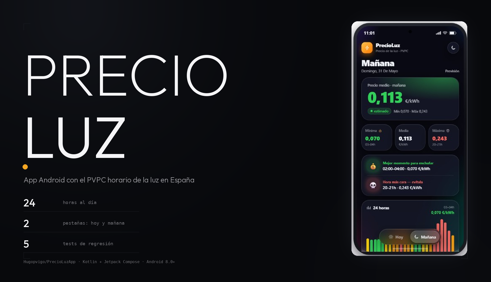
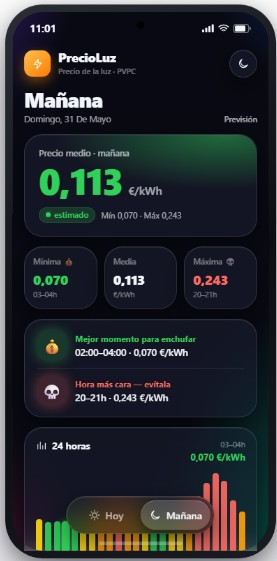
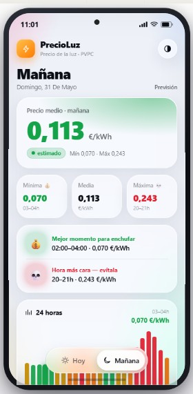

<p align="center">
  
</p>

<p align="center">
  <b>App Android con el precio horario de la luz en España.</b><br>
  Las 24 horas de hoy y de mañana, con la franja más barata para enchufar.
</p>

<p align="center">
  
  
  
  
  
</p>

---

## Qué es esto

Una app Android nativa para consultar el **PVPC horario de la luz** (indicador
1001 de Red Eléctrica, zona Península):

- Las **24 horas** de hoy y de mañana, con el mínimo, la media y el máximo.
- La **franja de dos horas más barata** para enchufar y la hora más cara.
- **Gráfico de 24 barras** coloreadas por cuartil (verde → rojo) y la lista
  hora a hora.

Kotlin, Jetpack Compose y Material 3, con MVVM (`StateFlow`) e inyección de
dependencias con Hilt. Sin cuenta, sin registro y sin configuración: se abre y
ya está.

## La app

| | |
|---|---|
|  |  |
| Pestaña de mañana, en modo oscuro. | La misma pantalla en modo claro. |

Dos pestañas, **Hoy** y **Mañana**:

- En **Hoy** la tarjeta principal muestra el precio de la hora actual, en qué
  tramo está (valle, llano o punta) y si el precio sube o baja a la hora
  siguiente.
- En **Mañana** muestra la media del día, marcada como *estimado*, con el
  mínimo y el máximo.
- Debajo, la misma estructura en las dos: mínima / media / máxima, la
  recomendación de enchufar, el gráfico de 24 horas y la lista horaria.

El botón de la cabecera alterna el tema **automático → claro → oscuro** y lo
recuerda entre sesiones.

## De dónde salen los precios

La app **no llama a REE directamente**: lee un JSON servido por
`precioluz.hugoperezvigo.es/api/precios`. Ese backend es a su vez una foto del indicador **1001 (PVPC 2.0TD)**
de la [API ESIOS de Red Eléctrica](https://api.esios.ree.es), de donde salen
los valores en €/MWh ya convertidos a €/kWh.

Gracias a ese intermediario la app cumple la política de REE de **una sola
consulta al día**: al abrir, primero mira la caché de Room y, si no está el
día, pide hoy y mañana en una sola llamada.

Un detalle que ya está resuelto: cuando REE sirve un día entero a 0 (el día
todavía no está publicado) la app **no lo muestra ni lo guarda**. Lo detecta,
lo expulsa de la caché y espera al día real. Hay una regresión cubierta por
tests (`isPlaceholderDay`).

Los precios de mañana se publican sobre las **20:15 (CET)**; antes de esa
hora la pestaña «Mañana» avisa de que aún no están.

## Compilar

Requiere **JDK 17** y el SDK de Android (compileSdk 36, build-tools 36.0.0).

```bash
./gradlew assembleDebug        # APK de debug
./gradlew assembleRelease      # APK de release
./gradlew testDebugUnitTest    # 5 tests unitarios
```

La firma de release busca el keystore en `~/.gradle/gradle.properties` con
`PRECIOLUZ_STORE_FILE`, `PRECIOLUZ_STORE_PASSWORD`, `PRECIOLUZ_KEY_ALIAS` y
`PRECIOLUZ_KEY_PASSWORD`. **Ni el keystore ni las contraseñas están en el
repo**: sin ellos el APK de release sale sin firmar.

`local.properties.template` deja el hueco para `ESIOS_API_TOKEN` (la clave
pública de REE, que se pide en `api_token@ree.es`). Hoy ese valor solo llega
al `BuildConfig`: la app no lo usa, porque los precios llegan ya convertidos
desde el backend. `local.properties` está en `.gitignore`.

## Estado del proyecto

- **Hecho**: pestañas de hoy y mañana, caché offline en Room, detección del
  día no publicado, tramos y cuartiles, tema claro/oscuro/automático y tests
  de regresión.
- **Pendiente: las notificaciones locales.** WorkManager está como
  dependencia y hay una pantalla de Ajustes con los interruptores
  (`ui/settings/SettingsScreen.kt`), pero no hay ningún `Worker` en el código:
  de momento no se avisa de nada, hay que abrir la app para ver los precios.
  El diálogo de Ajustes que sí se abre solo dice que los precios se obtienen
  sin configuración.

`Plan.md` recoge el diseño completo por sprints y `Changelog.md` los cambios.

## Repositorio

```
precioluzapp/
├── app/src/main/java/com/precioluz/app/
│   ├── data/          Room (caché), API, DataStore y repositorio
│   ├── di/            módulos Hilt (red, base de datos)
│   ├── domain/        modelos y casos de uso
│   └── ui/            pantallas (Hoy, Mañana, Ajustes) y componentes
├── app/src/test/      tests de regresión
├── src/               capturas de la app en modo claro y oscuro
├── docs/capturas/     cabecera e imágenes del README
├── Plan.md            diseño y sprints
├── Changelog.md
└── PrecioLuzApp.html  maqueta de la interfaz en HTML
```

## Proyectos relacionados

Los mismos datos se sirven en <https://precioluz.hugoperezvigo.es>, que es
justo el backend que consume la app; su código está en
[Hugopvigo/PrecioLuzWeb](https://github.com/Hugopvigo/PrecioLuzWeb).

## Licencia

El código de este repositorio está bajo **CC BY-NC-SA 4.0** (atribución, no
comercial y obras derivadas bajo la misma licencia). Véase
[LICENSE](LICENSE).

Las capturas son de la propia app.
